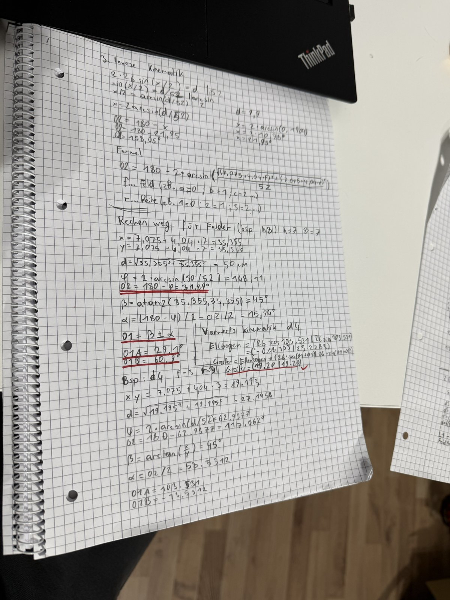
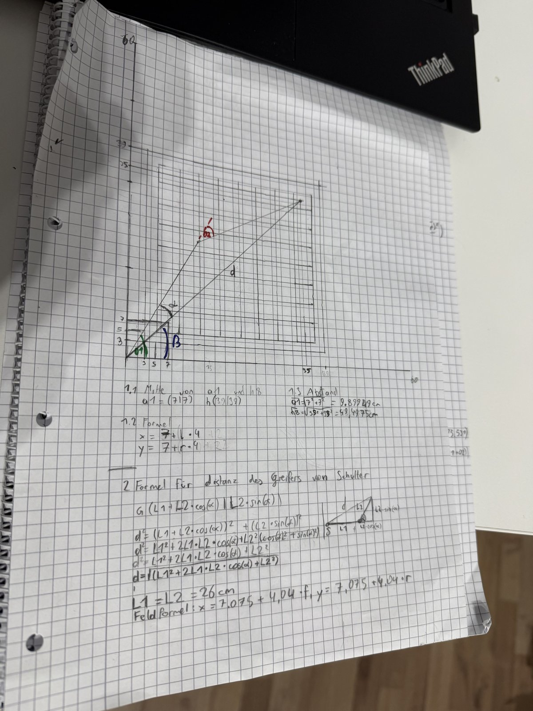

## Math: arm kinematics

The arm is a 2-link SCARA arm. Both links have the same length, which keeps the math simple.

| Symbol | Meaning | Value |
|---|---|---|
| $L$ | length of each link | 26 cm |
| $(x, y)$ | target point, shoulder at the origin | cm |
| $\theta_1$ | shoulder angle, measured from the x axis | deg |
| $\theta_2$ | elbow angle, relative to link 1 | deg |

### 1. Square to coordinates

The shoulder sits at the origin, diagonally off the a1 corner. Square centres:

$$x = 7.075 + 4.04 \cdot f \qquad y = 7.075 + 4.04 \cdot r$$

with $f$ = file (a = 0 … h = 7) and $r$ = rank (1 = 0 … 8 = 7).

Reach check: the nearest square a1 is $d = 10.01$ cm away, the farthest square h8 is $d = 50.0$ cm away. Both are inside the reachable ring $0 \le d \le 2L = 52$ cm.

### 2. Distance shoulder → gripper

With link 1 on the x axis, the gripper is at $G = (L_1 + L_2\cos\theta_2,\; L_2\sin\theta_2)$, so

$$d^2 = (L_1 + L_2\cos\theta_2)^2 + (L_2\sin\theta_2)^2 = L_1^2 + 2L_1L_2\cos\theta_2 + L_2^2$$

### 3. Inverse kinematics

Because $L_1 = L_2 = L$, the triangle shoulder–elbow–gripper is isosceles. With $\varphi$ as the inner angle at the elbow:

$$d = 2L\sin\frac{\varphi}{2} \;\Rightarrow\; \varphi = 2\arcsin\frac{d}{2L}$$

$$\theta_2 = 180^\circ - \varphi$$

The two base angles of the isosceles triangle are equal:

$$\alpha = \frac{180^\circ - \varphi}{2} = \frac{\theta_2}{2}$$

The direction to the target:

$$\beta = \operatorname{atan2}(y, x)$$

There are two solutions (elbow on either side):

$$\theta_1 = \beta + \alpha \;\text{ with }\; \theta_2 < 0 \qquad\text{or}\qquad \theta_1 = \beta - \alpha \;\text{ with }\; \theta_2 > 0$$

This project uses the **first one**. Over all 64 squares it keeps $\theta_1$ between 57.4° and 136.6°, so it fits a 0–180° servo without an offset. $\theta_2$ then spans −157.8° … −31.9°.

> Note: $\alpha = \theta_2 / 2$ only holds for equal link lengths. With different lengths, use the general law of cosines.

### 4. Forward kinematics (check)

$$\text{elbow} = (L\cos\theta_1,\; L\sin\theta_1)$$

$$\text{gripper} = \text{elbow} + (L\cos(\theta_1 + \theta_2),\; L\sin(\theta_1 + \theta_2))$$

### Worked examples

| Square | $(x, y)$ | $d$ | $\theta_1$ | $\theta_2$ | FK check |
|---|---|---|---|---|---|
| h8 | (35.355, 35.355) | 50.0 | 60.94° | −31.89° | ✓ |
| d4 | (19.195, 19.195) | 27.146 | 103.53° | −117.06° | (19.20, 19.20) ✓ |

`kinematics.py` runs IK → FK for all 64 squares as a self test: **64/64 ok**.

Note: my hand-written notes still use $d = 9.9$ cm for a1, from an earlier rough board measurement; the exact value from the board drawing is 10.01 cm.

### Hand-written notes

